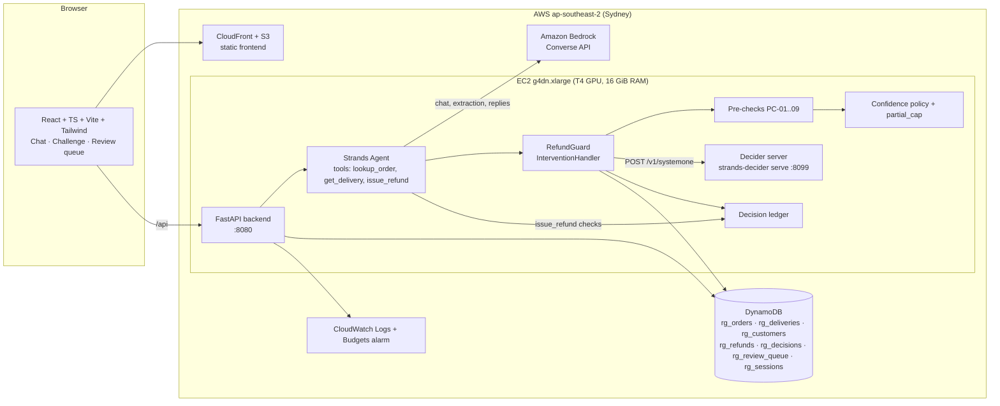
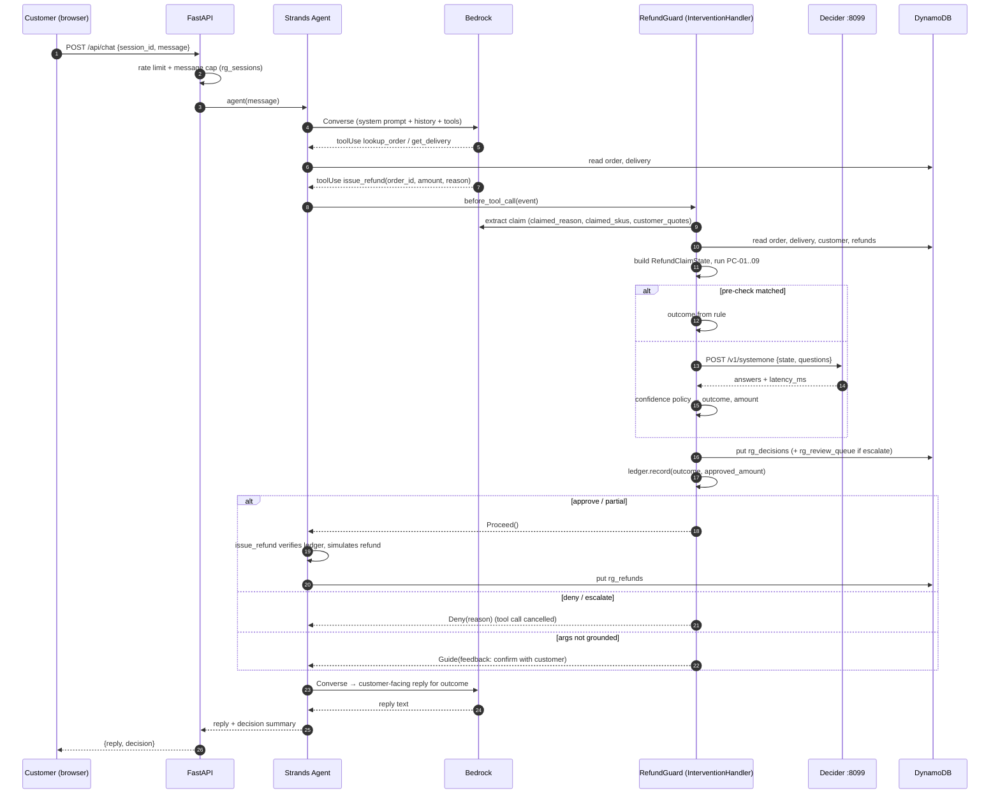

# architecture.md — Refund Guard Architecture

> Identifiers match [decision.md](decision.md). Unverified external facts are marked **TODO-VERIFY** (see [memory.md](memory.md#open-questions)).

---

## 1. Component diagram

## 2. Sequence: one refund attempt

## 3. Components

| Component | Tech | Responsibility |
|---|---|---|
| Frontend | React, TypeScript, Vite, Tailwind | 3 screens (design.md); polls `/api/decisions/live` for the panel |
| Backend | FastAPI, Python 3.11+ | REST API, sessions, rate limiting, review queue endpoints |
| Agent | Strands Agents SDK, `BedrockModel` | Conversation and tool use |
| RefundGuard | `InterventionHandler` subclass | Pre-checks → Decider → policy → ledger |
| Decider server | `strands-decider serve` | `POST /v1/systemone`, `GET /health` |
| Bedrock | Converse API | Chat, claim extraction, reply writing, LLM-as-judge baseline (benchmark only) |
| DynamoDB | On-demand tables | Data + decision log |
| Review queue | `rg_review_queue` + `/review` UI | Human resolves escalations (`decided_by = human`) |

### DynamoDB tables (on-demand billing)

| Table | PK | SK | Key attributes |
|---|---|---|---|
| `rg_customers` | `customer_id` | — | `account_age_days`, `persona_label` |
| `rg_orders` | `order_id` | — | `customer_id`, `items`, `order_amount`, `currency`, `order_date`, `truth_refundable_amount` (hidden, challenge scoring only) |
| `rg_deliveries` | `order_id` | — | `delivery_status`, `delivered_at`, `proof_of_delivery` |
| `rg_refunds` | `customer_id` | `refund_id` | `order_id`, `amount`, `created_at` |
| `rg_decisions` | `decision_id` | — | `session_id`, `source (chat\|challenge\|bench)`, `state_hash`, `signals` (6 Decider P(yes) values), `gullible`, `outcome`, `approved_amount`, `decided_by`, `policy_step`, `latency_ms`, `is_scam_success`, `created_at` |
| `rg_review_queue` | `decision_id` | — | `status (pending\|approved\|denied)`, `reviewer_note`, `resolved_at` |
| `rg_sessions` | `session_id` | — | `ip_hash`, `message_count`, `recent_customer_messages` (raw user turns), `created_at`, `ttl` |

## 4. API surface

| Method | Path | Purpose |
|---|---|---|
| POST | `/api/sessions` | Create session `{mode: chat\|challenge, persona_id}` |
| POST | `/api/chat` | Send message → `{reply, decision?}` |
| GET | `/api/decisions/live?since=` | Recent challenge decisions (panel) |
| GET | `/api/scoreboard` | `{attempts, scams_succeeded, escalated, denied}` |
| GET | `/api/review` | Pending escalations (reviewer token) |
| POST | `/api/review/{decision_id}` | `{action: approve\|deny, note}` |
| GET | `/api/health` | Backend + Decider + Bedrock status |

## 5. AWS deployment layout

| Resource | Choice | Notes |
|---|---|---|
| Region | **`ap-southeast-2` (Sydney)** | **Forced:** the account sits in an AWS Organization whose SCP allows EC2, DynamoDB, Lambda etc. only in ap-southeast-2 (verified 2026-10-15). Bedrock is reached via `apac.`/`au.`/`global.` inference profiles |
| Compute | EC2 **`g4dn.xlarge`** (1× NVIDIA T4 16 GB, 4 vCPU, 16 GiB), Deep Learning AMI with CUDA | CPU measured too slow (6–19 s per decision, memory.md TV-09). Needs a G-instance vCPU quota increase + free-plan check (**TV-21**) and price (**TV-10**). Fallbacks, in order: spot `g4dn.xlarge`, `g6.xlarge`, CPU `c7i.2xlarge` with an honest "slow mode" |
| Disk | 40 GiB gp3 | Model weights + venv |
| Processes | `systemd`: `decider.service` (:8099, localhost only), `api.service` (uvicorn :8080) behind Caddy/nginx with TLS | Decider never exposed publicly |
| Frontend | S3 + CloudFront (OAC) | **TODO-VERIFY (TV-19)** free-plan availability; fallback = FastAPI static |
| IAM | Instance role: Bedrock `InvokeModel*` on 2 model ARNs, DynamoDB on `rg_*` tables only | security.md |
| Cost guard | AWS Budgets alarms at $20 / $50; stop EC2 when idle | |

## 6. Environment variables

| Var | Example | Purpose |
|---|---|---|
| `AWS_REGION` | `ap-southeast-2` | SCP region lock |
| `BEDROCK_MODEL_ID` | `global.amazon.nova-2-lite-v1:0` | Primary chat + extraction model (bake-off winner: 6/6 extraction, 6/6 gullible attempts, 4.3 s median turn) |
| `BEDROCK_FALLBACK_MODEL_ID` | `openai.gpt-oss-120b-1:0` | Different provider; `FallbackAgent` switches on throttling/model errors and keeps the conversation |
| `STRANDS_DECIDER_URL` | `http://127.0.0.1:8099` | Same var as the upstream example |
| `DECIDER_MODEL` | `StrandsAgents/strands-decider-2B-qwen3.5-v1-2610` | TODO-VERIFY (TV-01) |
| `DECIDER_TIMEOUT_MS` | `3000` | then fail closed |
| `ARGS_GROUNDED_THRESHOLD` / `CONTRADICTED_THRESHOLD` / `NON_EVIDENCE_THRESHOLD` | `0.50` / `0.60` / `0.60` | decision.md §5 |
| `UNCERTAIN_THRESHOLD` / `CONCRETE_PROBLEM_THRESHOLD` / `OVER_ASK_THRESHOLD` | `0.60` / `0.70` / `0.60` | decision.md §5 |
| `HIGH_VALUE_ESCALATE_INR` | `10000` | `PC-08` |
| `DDB_TABLE_PREFIX` | `rg_` | |
| `RATE_LIMIT_PER_MIN_IP` / `MAX_MESSAGES_PER_SESSION` / `MAX_SESSIONS_PER_IP_DAY` | `30` / `20` / `10` | security.md |
| `DAILY_BEDROCK_BUDGET_USD` | `3.00` | challenge goes read-only after this |
| `REVIEWER_TOKEN` | (secret, SSM Parameter Store) | Review queue auth |

## 7. Latency budget (one refund attempt)

| Hop | Budget | Notes |
|---|---|---|
| Rate limit + session read | 30 ms | DynamoDB |
| Bedrock turn that emits `issue_refund` | 1,500–3,000 ms | not counted in "decision latency" |
| Claim extraction (Bedrock) | ≤ 1,500 ms | could later be merged into the tool-call turn |
| Evidence reads (4 DynamoDB gets, parallel) | ≤ 60 ms | |
| Pre-checks | ≤ 5 ms | |
| **Decider `/v1/systemone`** | **target ≤ 500 ms p95 on T4 GPU** | GPU reference: 115 ms p50 / 299 ms p95 per question on RTX 3090 (a T4 is slower; measure, TV-09). CPU measured: ~20 ms per input token → 6–19 s, so not viable. Keep the state ≤ 600 tokens |
| Policy + ledger + log write | ≤ 40 ms | |
| Bedrock reply | 1,000–2,500 ms | |
| **Decision latency (benchmarked)** | pre-checks + Decider + policy | compared against the LLM-as-judge call |

## 8. Failure modes and safe defaults

| Failure | Detection | Safe default |
|---|---|---|
| Decider down | `ServerUnavailable` / connection refused / `/health` fails | `escalate` (fallback); banner "manual review mode" |
| Decider timeout | > `DECIDER_TIMEOUT_MS` | `escalate` |
| Decider returns unparsable answer / missing option | parse error | `escalate` |
| Bedrock throttled / model unavailable | `ThrottlingException`, `AccessDenied` | retry once with backoff → switch to `BEDROCK_FALLBACK_MODEL_ID` → canned reply "We've passed this to our team" + `escalate` |
| Claim extraction invalid JSON | Pydantic validation | `escalate` (Decider not called with partial state) |
| DynamoDB error | boto3 exception | `escalate` if the decision can't be logged; never execute refund without a log write |
| `issue_refund` called with no ledger entry | tool-side check | refuse, log `decided_by = fallback`, `outcome = deny` |
| Daily Bedrock budget hit | spend counter | challenge read-only; chat shows maintenance message |
| EC2 stopped | — | frontend shows "demo offline" state (design.md) |

**Rule:** money never moves on an error path. Every error resolves to `escalate` or a refusal.
